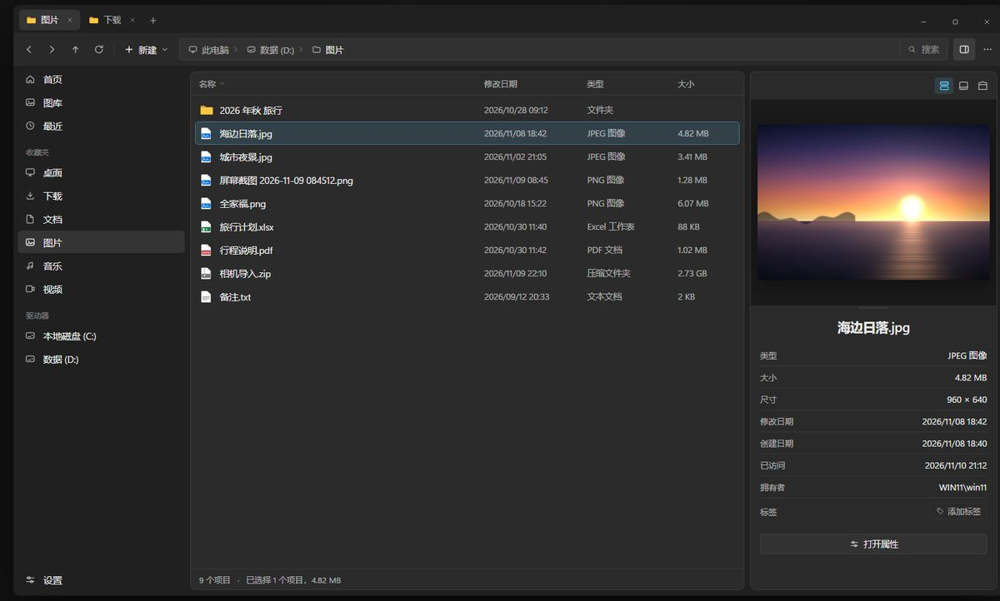
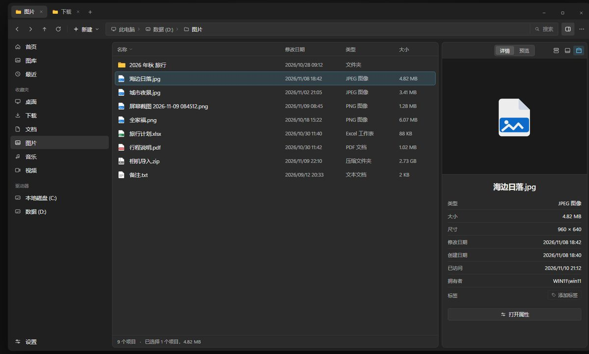
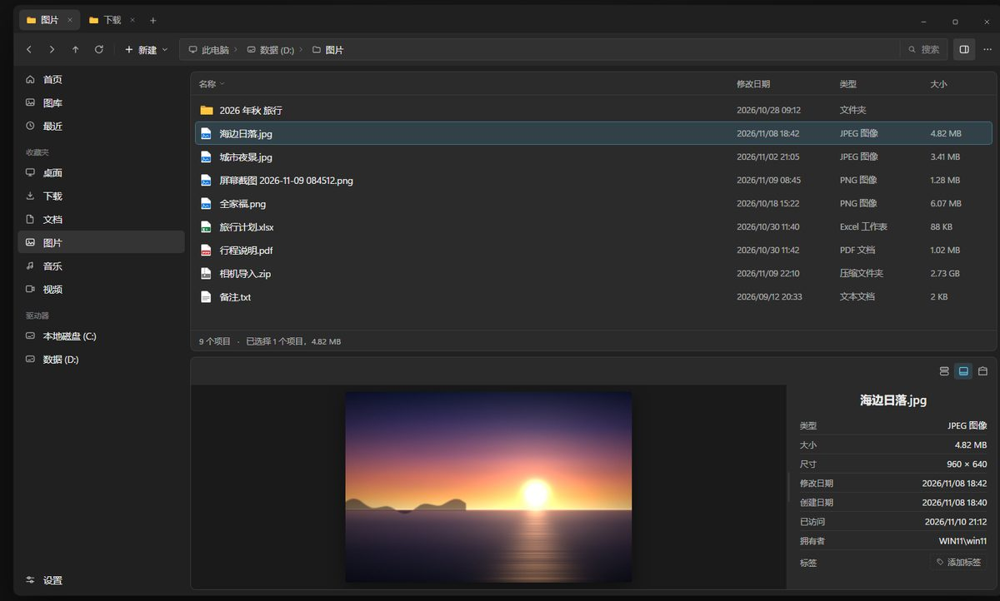
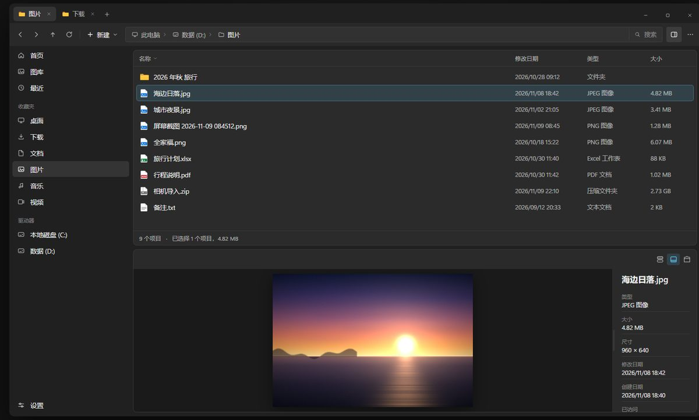

# 预览窗位置模式设计

- 日期：2026-11-10
- 状态：待评审
- 相关原型：[`assets/preview-pane/prototype.html`](assets/preview-pane/prototype.html)（自包含 HTML，双击即可交互；属于本规格的一部分）
- 影响范围：Info Pane（预览窗）、主窗口布局、Info Pane 设置

## 1. 背景与动机

现在预览窗的位置不是用户选的：窗口够宽就放右侧，窄于 700 px 自动挪到列表底部；右侧的"详情"标签页里显示的其实是 `BasicPreview`——把文件图标/缩略图塞进 `Viewbox` 拉满整块，放大后很模糊，并不是真正的预览。同时，横屏下把预览放到列表下方能明显提高屏幕利用率，但当前无法主动选择。

这次要做的是：把"位置"变成用户可选的模式，位置控件放在预览区内部（子交互，不占工具栏），并修掉详情标签页里的模糊图标。

## 2. 目标

1. 预览窗提供三种位置模式，可随时切换并记住：
   - **右侧 · 上下两行（默认）**：上真预览、下详情，中间分隔条可拖比例。
   - **右侧 · 标签页**：详情 / 预览二选一，各自占满整块高度。
   - **底部通栏**：预览左、详情右，铺满文件列表下方。
2. 位置按钮放在预览区顶部右侧，顺序固定为：**上下两行 → 底部 → 标签页（最右）**；当前模式高亮。
3. 打开预览窗时按上次记住的模式显示；应用启动时预览窗仍默认不显示，用户点工具栏按钮（Ctrl+Alt+I）打开。
4. 上下两行 / 底部模式下始终显示**真实预览**（Shell、文本、代码、富文本、文件夹）；标签页模式的"详情"页维持现状（基础预览 + 详情），"预览"页显示真实预览。
5. 所有尺寸可调并分别记住：右侧宽度、底栏高度、上下两行比例、底部模式下的详情列宽（可压到 132 px，窄时详情换紧凑排版）。

## 3. 非目标

- 不改工具栏预览开关的语义（仍是开 / 关），也不新增位置入口到工具栏或设置页。
- 不新增第四种位置（左侧、浮动窗口、独立窗口）。
- 不重写预览加载管线；预览仍走现有的 Shell / 文本 / 代码 / 富文本 / 文件夹分支。
- 不改变其它页面（设置、发布说明）下预览窗已有的空状态行为。
- 不为位置模式复制出多套 Info Pane 控件或重复 XAML 布局。

## 4. 反目标

- 位置按钮不能变成占地方的主操作，也不应挤进工具栏。
- 不能为了布局分叉而复制 `InfoPane.xaml`，或在 XAML 里硬编码用户可见字符串。
- 不能用 JSON/新服务在组件间传布局状态；直接走现有设置服务。
- 不能为兼容旧行为保留"按窗口宽度自动翻转"，因为那会让用户的选择失效。

## 5. 原型摘要

交互原型随规格一起交付：[`assets/preview-pane/prototype.html`](assets/preview-pane/prototype.html)。它是自包含的单文件 HTML（图片已内嵌，不依赖网络和本地服务），用浏览器直接打开即可；按 1440×860 窗口、1:1 尺寸渲染，覆盖三种位置模式和关闭态、暗色 / 明亮主题，以及所有拖拽交互。

原型里有两组切换控件：页面顶部那排是审阅用的，不属于应用界面；预览区右上角的三个图标才是应用内新增的控件。读数与布局以 §6、§7 的文字为准，原型里的窗格宽度（360 px）、底栏高度（340 px）只是 1440 宽窗口下的展示值，应用默认值见下表。

原型里的详情行画成了左右两列，这是为压缩画面做的近似；真实应用是"标签在上、值在下"，以实现为准（详见 6.4）。

截图见下（1200 px 宽的归档版本）：









原型尺寸只作示意（1440 宽窗口下的展示值）；默认值与约束只在 §7.2 出现一次，实现时不要照抄原型的像素。

## 6. 交互规格

### 6.1 位置按钮

- 位置：预览区顶部栏（与"详情 / 预览"胶囊同一行）的右侧，右对齐。
- 数量与顺序：3 个，从左到右 `上下两行`、`底部`、`标签页`。
- 视觉：默认透明底、次级图标色；悬停显示浅色底；当前模式用 accent 10% 底 + accent 图标（与现有 toggle 按钮一致）。
- 点击立即切换布局并持久化；不关闭预览窗，不刷新选中项。
- 可访问性：每个按钮都要有 `AutomationProperties.Name` 和 ToolTip，文本来自资源：`PreviewPaneLayoutRightSplit`、`PreviewPaneLayoutBottom`、`PreviewPaneLayoutRightTabs`。
- 按钮只在预览窗打开时存在（预览窗本身是容器）。

### 6.2 "详情 / 预览"胶囊

- 只在**标签页**模式显示，仍居中，样式不变。
- 上下两行、底部模式不显示胶囊（两块同时可见，没有可切换的"页"）。
- 关闭预览窗再打开时保留上次选中的页。

### 6.3 各模式布局

**右侧 · 上下两行（默认）**

- 窗格宽度 = `VerticalSizePx`；右侧两种模式共用同一个下限 300 px（见 7.2）。
- 内容区：预览在上，详情在下，中间一条分隔条（复用 `DefaultGridSplitterStyle`，命中区不小于 8 px，光标为上下箭头）。
- 预览占比 = `SplitRatio`，默认 0.42，范围 0.22–0.72；拖动分隔条更新，`ManipulationCompleted` 时写回设置。
- 拖正文分隔条不改窗格宽度。

**右侧 · 标签页**

- 窗格宽度 = `VerticalSizePx`，与上下两行共用同一个下限 300 px：居中的胶囊加右侧三个 24 px 按钮大约需要 300 px 才不重叠，所以两个右侧模式统一这个下限，不做按模式分支。
- 内容区由 `SelectedTab` 决定：
  - 详情：**维持现状**——上方基础预览（`BasicPreview`：图标 / 缩略图拉伸），下方详情，比例 2:3。
  - 预览：真实预览占满整块。
- 详情页的基础预览是刻意保留的：它不需要加载预览处理器，和"预览"页分工。

**底部通栏**

- 窗格高度 = `HorizontalSizePx`（不小于 140 px），宽度铺满文件列表下方。
- 内容区左右并排：预览列 `*`，详情列宽 = `BottomDetailsWidthPx`；132 px 作为详情列的 `MinWidth`，不做百分比截断。
- 中间一条竖直分隔条（复用 `DefaultGridSplitterStyle`，命中区不小于 8 px，光标为左右箭头），拖动更新 `BottomDetailsWidthPx`。
- 不显示"详情 / 预览"胶囊。
- 详情列窄时按 6.4 自然换行；"打开属性"按钮三种模式都保留，高度不够时随详情一起滚动。

**关闭态**

- 与现在一致：窗格不加载，工具栏按钮不按下。

### 6.4 详情在窄列的显示

- 现有详情模板本来就是"标签在上（Caption、次级色）、值在下"，**不需要**新增紧凑布局状态或第二套模板。
- 窄列（最小 132 px）时依靠现有 `TextWrapping="Wrap"` 自然换行；只需要保证外层不出现横向滚动条。
- "添加标签"已使用 `WrapPanel`，窄列下会自己换行，验证即可。

### 6.5 预览内容规则

| 模式 | 预览行为 |
| --- | --- |
| 上下两行 | 始终加载真实预览（与"预览"页相同的加载路径），不受 `SelectedTab` 影响 |
| 底部通栏 | 始终加载真实预览，不受 `SelectedTab` 影响 |
| 标签页 · 预览 | 加载真实预览 |
| 标签页 · 详情 | 维持现状：加载 `BasicPreview`（图标 / 缩略图），同时显示详情 |

- `BasicPreview` 整条链路保留：详情页、快捷方式、可浏览 zip、回收站非文件夹项、无处理器兜底，共 5 处调用，都不删除。
- 需要改的只是"何时走真实预览"：`Layout` 为上下两行 / 底部时，无论 `SelectedTab` 是什么都走真实预览；为标签页时保持现有分支逻辑。
- "无可用预览"沿用现有 `NoPreviewAvailable` 状态（预览区文案 + 详情可见），不新增分支。
- 详情区可见性独立于预览状态：上下两行 / 底部模式强制"预览 + 详情"两块可见（即使上次停在"预览"页），只有标签页模式按 `SelectedTab` 决定；`LoadingPreview` 不得把详情隐藏。
- 保留现有的加载取消与版本号机制（`UpdateSelectedItemPreviewAsync`、`previewRequestVersion`、延迟入队），切换选中项时旧请求必须作废。

### 6.6 位置决策

- 位置完全由 `PreviewPaneLayout` 设置决定，删除 `InfoPane.UpdatePosition` 里"宽度 > 700 就右侧、否则底部"的推断。
- 只保留一个位置枚举：删除 `PreviewPanePositions` 与 `InfoPane.Position`，`MainPage` 直接按 `Layout` 分支（现有枚举只有两个引用点）。
- 窗口变窄不再自动翻转模式；空间不足由用户自己改模式，或者由窗格的最小宽度限制压缩文件列表。
- 切换模式后，主窗口的 `InfoPanePositionStates` 立即切到对应状态，并保留该模式上次的尺寸。

## 7. 数据与持久化

### 7.1 新枚举

`src/Files.App/Data/Enums/PreviewPaneLayout.cs`：

```csharp
public enum PreviewPaneLayout
{
    RightSplit,
    RightTabs,
    Bottom,
}
```

### 7.2 新设置项

在 `IInfoPaneSettingsService` / `InfoPaneSettingsService` 增加：

| 成员 | 类型 | 默认 | 约束 |
| --- | --- | --- | --- |
| `Layout` | `PreviewPaneLayout` | `RightSplit` | — |
| `SplitRatio` | `double` | `0.42` | 限制在 0.22–0.72 |
| `BottomDetailsWidthPx` | `double` | `300` | 不小于 132；132 同时作为详情列的 `MinWidth` |

复用：`VerticalSizePx`（右侧宽度）、`HorizontalSizePx`（底栏高度）、`IsInfoPaneEnabled`、`SelectedTab`。

右侧两种模式的最小宽度统一为 300 px：`VerticalSizePx` 的默认值从 250 调到 300；保存值小于 300 时按 300 应用，拖动到更小时也按 300 写回，避免"存 250、显示 300、再回写 250"的来回。

`UserSettingsJsonSerializationContext` 增加 `[JsonSerializable(typeof(PreviewPaneLayout))]`。

### 7.3 记忆范围

设置是全局的（所有标签页共用），与现有窗格尺寸一致；切换标签页不改变模式，也不重置尺寸。

### 7.4 尺寸写回时机

- 右侧宽度：窗格左侧分隔条 `ManipulationCompleted` → `VerticalSizePx`（现有逻辑）。
- 底栏高度：底栏上沿分隔条 `ManipulationCompleted` → `HorizontalSizePx`（现有逻辑）。
- 上下两行比例：分隔条 `ManipulationCompleted` → `SplitRatio`。
- 详情列宽：竖直分隔条 `ManipulationCompleted` → `BottomDetailsWidthPx`。
- 拖动过程中只改视觉，不逐帧写设置。

## 8. 实现落点

| 位置 | 改动 |
| --- | --- |
| `Data/Enums/PreviewPaneLayout.cs` | 新增枚举 |
| `Data/Contracts/IInfoPaneSettingsService.cs` | 新增三处属性契约 |
| `Services/Settings/InfoPaneSettingsService.cs` | 默认值与范围限制 |
| `Services/Settings/UserSettingsService.cs` | 序列化上下文注册枚举 |
| `UserControls/Pane/InfoPane.xaml` | 顶部位置按钮组；上下两行的分隔条行；底部模式的列定义与竖直分隔条；详情列 `MinWidth=132`；修正 `RootPropertiesScrollViewer.Column` 缺 `(Grid.Column)` 的现有笔误 |
| `UserControls/Pane/InfoPane.xaml.cs` | 位置由设置驱动（删除 `PreviewPanePositions` / `Position`）；分隔条拖动与写回；上下两行 / 底部强制详情可见 |
| `ViewModels/UserControls/InfoPaneViewModel.cs` | 只调整"何时走真实预览"：`Layout` 为上下两行 / 底部时忽略 `SelectedTab`、直接加载真实预览；标签页模式保持现有分支（含 `BasicPreview`） |
| `Views/MainPage.xaml.cs` | `UpdatePositioning` 按 `Layout` 切状态，删除宽度推断与 `Position` 引用；右侧宽度统一 `Max(300, VerticalSizePx)`；监听 `Layout` 变化 |
| `Views/MainPage.xaml` | `InfoPanePositionStates` 沿用，必要时补 setter |
| `Strings/en-US/Resources.resw` | 三条按钮文案（名称 / 提示） |
| `Data/Enums/InfoPaneTabs.cs` 等 | 无改动，继续用于标签页模式 |

说明：

- 三组 VisualState 会往同一批属性写值：页签组在 `SelectedTab=Preview` 时把 `PropertiesRow.Height` / `PropertiesColumn.Width` 设为 0 并隐藏详情，`LoadingPreview` 也隐藏详情。上下两行 / 底部模式必须在应用布局时把详情恢复为可见并重新给出行列尺寸，否则会出现"胶囊已隐藏、详情却为 0 高"的死角。
- 位置按钮的本地化沿用 `helpers:ResourceString` 与 `Strings.*` 生成方式，不硬编码。
- Info Pane 是单实例、被所有标签页共用；设置变化时要广播到主窗口并重算布局（现有 `MainPage` 已监听 `IInfoPaneSettingsService` 的部分键）。

## 9. 约束

- WinUI 3 + 现有 MVVM / 命令 / 设置 / 本地化模式；不新增一次性样式，复用 `App.Theme.*` 画刷与现有 `GridSplitter` 样式。
- 文本文件保持 CRLF；遵守 `.editorconfig`。
- 不新增 P/Invoke、COM 或 CsWin32 声明（本次不涉及原生互操作）。
- 完成后需按 `AGENTS.md` 走打包流程（`Build-Internal.ps1`，无签名需求时加 `-PortableOnly`），并对受影响的 UI 做冒烟验证。
- 真预览在默认模式下要一直加载，注意大文件、网络路径和快速切换选中项时的取消与延迟入队，避免卡住文件列表。

## 10. 决策清单

**用户确定的**

- 三种模式及默认（右侧上下两行）。
- 启动时预览窗仍不显示，点工具栏按钮打开。
- 位置按钮放在预览区里，属于子交互。
- 按钮顺序：上下两行、底部、标签页（标签页最右）。
- 标签页模式保留，因为有些文件的详情很长，需要整块高度。
- 底部模式的高度可调。
- 底部模式详情列宽可调，并且要能压到很小。
- 详情标签页保留基础预览（放大图标 / 缩略图），维持现状。

**我做的决定（可被推翻）**

- 上下两行比例默认 0.42，范围 0.22–0.72。
- 详情列最小 132 px；紧凑排版阈值 200 px。
- 窄窗口不再自动翻转到底部，用户选择优先。
- 尺寸与模式全局记忆，不按标签页区分。
- 不做设置页入口，位置只在预览区切换。
- 右侧两种模式统一最小宽度 300 px，`VerticalSizePx` 默认值同步从 250 调到 300。

## 11. 验收清单

1. 启动后预览窗关闭；点工具栏按钮或 Ctrl+Alt+I 打开，显示上次记住的模式。
2. 三个位置按钮顺序正确、高亮跟随、切换即时生效、重启后保留。
3. 上下两行：上面是真实预览（图片、PDF、文本各测一个），下面是详情；拖动分隔条比例改变并保存。
4. 标签页：详情页显示基础预览 + 详情（与现状一致，2:3），预览页为真实预览；两页切换正常。
5. 底部：高度可拖并保存；详情列宽可拖并保存；拖到 132 px 时详情自然换行、不横向溢出；拖回变宽恢复。
6. 窗口缩到 700 px 以下时不再自动翻转位置。
7. 选中文件夹、多选、无选中、无预览文件时各模式的空状态正确。
8. 深色、浅色、高对比度下按钮与分隔条可见；分隔条光标方向正确。
9. 快速连续切换选中项时预览不串台（旧请求被取消）。
10. 关闭预览窗再打开，模式与尺寸不变。

## 12. 留给建造者的空间

- 具体 XAML 结构（新增行/列还是复用现有行列）、分隔条的精确厚度（命中区不小于 8 px 即可）。
- 位置按钮图标的具体画法，只要与"两行 / 底栏 / 标签页"语义一致即可。
- 资源键命名与提示文案措辞。
- 是否顺手把"详情 / 预览"胶囊的选中态跟随 `SelectedTab` 的现有实现一并整理。
